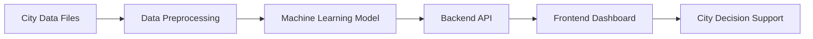

# AI Smart City Digital Brain

## Title
Intelligent Urban Decision Support System Using Machine Learning for Smart City Management

## Abstract
AI Smart City Digital Brain is an intelligent urban decision-support system that uses machine learning to predict city challenges such as traffic congestion, air pollution, and energy demand. The system helps city administrators make proactive and data-driven decisions by combining data analytics, predictive modeling, and a web-based interface for real-time insight and planning.

## Project Overview
AI Smart City Digital Brain is an intelligent urban decision-support system that uses machine learning to predict city challenges such as traffic congestion, air pollution, and energy demand. The system helps city administrators make proactive and data-driven decisions by integrating predictive analytics, data visualization, and automated decision support into a unified smart-city platform.

## Problem Statement
Modern cities face growing pressure from traffic congestion, pollution, rising energy consumption, and delayed emergency response. Traditional city management systems often focus on monitoring historical data without providing predictive insights or actionable recommendations. This project addresses that gap by developing an AI-enabled decision-support system that can forecast urban risks and assist city officials in making timely, evidence-based decisions.

## Objectives
- Develop an intelligent decision-support system for smart city management
- Apply machine learning techniques to forecast urban risks and operational demand
- Design a user-friendly dashboard for city administrators and stakeholders
- Demonstrate how AI-driven analytics can support proactive urban planning and resource allocation

## Scope of the Project
The project focuses on three major urban domains:
- Traffic management
- Pollution monitoring
- Energy demand forecasting

## Methodology
1. Collect and structure city-related datasets for traffic, pollution, and energy domains
2. Preprocess and transform the data for machine learning model development
3. Train and evaluate classification models to predict urban conditions and demand levels
4. Expose prediction results via a RESTful backend and interactive dashboard interface
5. Validate the system as an intelligent prototype for smart-city decision support

## Project Structure
ai-smart-city-digital-brain/
├── Backend/
│   ├── app.py
│   ├── database.py
│   ├── ml_model.py
│   └── requirements.txt
├── Frontend/
│   ├── index.html
│   ├── style.css
│   └── script.js
├── Dataset/
│   ├── traffic_data.csv
│   ├── pollution_data.csv
│   └── energy_data.csv
├── Models/
│   └── smart_city.db
└── README.md

## System Architecture
The system follows a three-layer architecture:
- Data Layer: CSV datasets and SQLite storage
- Application Layer: Flask REST API for predictions and analytics
- Presentation Layer: Interactive dashboard for admin decision support

## Features
- Predicts urban risks using supervised machine learning models
- Visualizes smart-city data through an interactive web dashboard
- Provides a REST API for real-time insight generation and prediction requests
- Stores prediction history for review and administrative analysis
- Supports future extension with real-time sensors, cloud deployment, and advanced analytics

## UrbanOS live-monitoring upgrade

The dashboard now uses the Flask API for city and area telemetry, operational KPIs, prediction history, and persisted incidents. The included telemetry is **dataset-derived simulated data** (`data_source: "simulated_dataset"`); it is intentionally not represented as a live municipal feed.

New API endpoints:

- `GET /live-data` — timestamped city/area telemetry and source label
- `GET /incidents?status=open` — deduplicated anomaly incidents stored in SQLite
- `PATCH /incidents/<id>` — set `status` to `open`, `acknowledged`, or `resolved`
- `GET /events` — one-shot Server-Sent Event payload for lightweight clients

Additional upgrade endpoints:

- `GET /intelligence` - dataset-derived traffic, air, water, energy, parking, and response forecasts
- `POST /assistant` - UrbanOS city-condition question answering over the current demo telemetry
- `POST /digital-twin` - what-if simulation for traffic, rain, and event-size assumptions

The upgraded dashboard includes 30 Indian city centers plus local area markers, four-level incident presentation, model confidence, browser notifications for critical incidents (after operator permission), an AI city assistant, smart-city module cards, and a digital-twin simulator. All generated telemetry remains visibly labeled **simulated dataset** or **demo intelligence**. The trained classifiers use the supplied CSV files and expose their validation limitation when the sample size is insufficient.

Run the backend with `python Backend/app.py`, then serve `Frontend/` (for example, VS Code Live Server). The dashboard refreshes simulated dataset telemetry every 30 seconds. Local development CORS permits `localhost` and `127.0.0.1` on any port. For phone/LAN access, replace `127.0.0.1` in `Frontend/script.js` with the machine's LAN address and add the frontend's exact LAN origin to the Flask CORS configuration; localhost points to the phone itself.

## Technologies Used
- Python
- Flask REST API
- JavaScript
- HTML/CSS
- Pandas
- Scikit-learn
- SQLite Database
- Machine Learning for predictive analytics

## How to Run
1. Install Python dependencies:
   pip install -r Backend/requirements.txt
2. Start the backend server:
   python Backend/app.py
3. Open the frontend file in a browser:
   Frontend/index.html

## Project Flow


## Implementation Details
The backend is developed using Flask and exposes REST endpoints for traffic, pollution, and energy predictions. The frontend uses HTML, CSS, and JavaScript to provide an interactive dashboard, while SQLite stores prediction history for later review. The machine learning workflow is implemented using Scikit-learn classification models trained on structured sample data for smart-city scenarios.

## Results and Evaluation
The system successfully demonstrates predictive analytics for three urban decision areas: traffic intensity, pollution status, and energy demand level. The prototype offers real-time predictions through the dashboard and supports future scalability through a modular architecture and database-backed history tracking.

## Sample Output
Example API response:
```json
{
  "project": "AI Smart City Digital Brain",
  "status": "running",
  "message": "Intelligent urban decision support system"
}
```

## Screenshots
This project can be demonstrated through the frontend dashboard and the API responses from the backend.

## Conclusion
This project demonstrates how artificial intelligence can be applied to smart city management by identifying potential urban risks and providing a practical decision-support framework for city administrators. It offers a strong foundation for future development into a more advanced, real-time, and scalable intelligent urban management system.

## Future Scope
- Add real-time data integration
- Improve prediction accuracy with advanced models
- Deploy as a cloud-based smart city platform
